<div align="center">


<h1 dir="rtl">۳۰نما برای مک، ویندوز، اندروید TV و Apple TV</h1>

<p dir="rtl">برنامه‌های غیررسمی و بومی ۳۰نما برای مک، ویندوز، اندروید TV و Apple TV.</p>

<p>
<a href="https://github.com/thesaikodelik/30nama-apps/releases/latest"></a>
<a href="https://github.com/thesaikodelik/30nama-apps/releases/latest"></a>
<a href="https://github.com/thesaikodelik/30nama-apps/releases/latest"></a>
</p>

<p>


</p>

<p dir="rtl">
<a href="#mac">نسخهٔ مک</a> ·
<a href="#windows">نسخهٔ ویندوز</a> ·
<a href="#android">نسخهٔ اندروید TV</a> ·
<a href="#features">Apple TV</a> ·
<a href="CHANGELOG.md">تازه‌ها</a> ·
<a href="#story">داستان پروژه</a> ·
<a href="#run">ساختن از روی کد</a> ·
<a href="#contribute">همکاری</a>
</p>

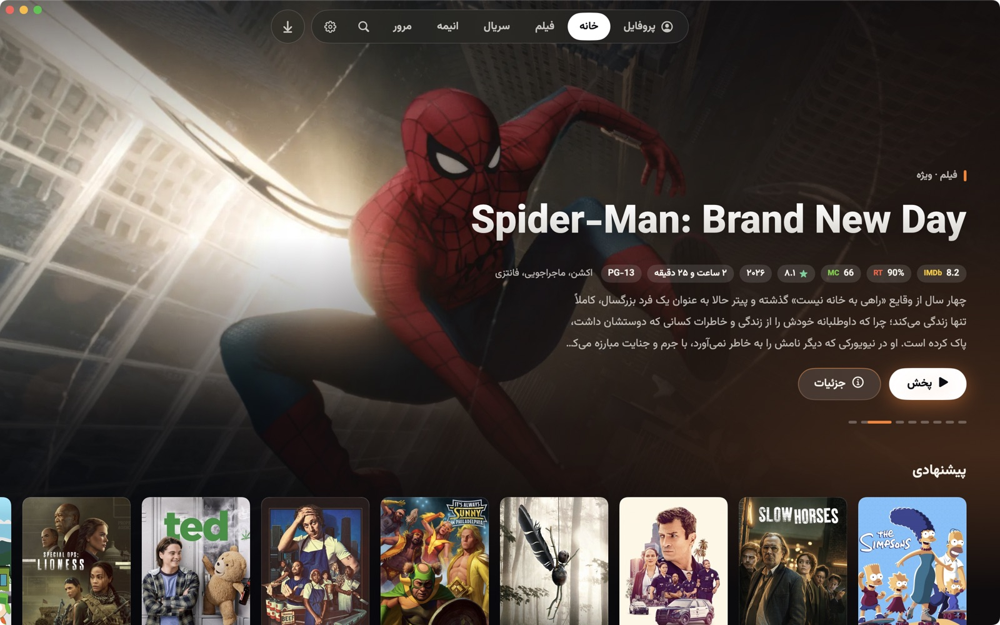

</div>

<div dir="rtl">

## این پروژه چیست

۳۰نما برای مک، ویندوز، اندروید TV و Apple TV برنامهٔ بومی و به‌روزی ندارد. این پروژه همان جای خالی را پر می‌کند: چهار برنامه که با حساب خودتان در [30nama.com](https://30nama.com) کار می‌کنند.

- **مک و ویندوز** برای موس و کیبوردند و دانلود و پخش فایل‌های MKV را هم دارند. ظاهر و امکاناتشان یکی است.
- **اندروید TV** و **Apple TV** برای کار با کنترل تلویزیون ساخته شده‌اند. ظاهر نسخهٔ اندروید TV همان ظاهر مک است، در اندازهٔ تلویزیون.

برنامهٔ مک و برنامهٔ Apple TV از یک کد Swift ساخته می‌شوند. برنامهٔ ویندوز کد خودش را دارد، با C#، و برنامهٔ اندروید TV با Kotlin، ولی منطق هر دو از همان هسته برگردانده شده و هر تغییری در یکی به بقیه هم می‌رسد.

نقطهٔ شروع، کلاینت تایزن [msharifi99/30nama-tizenos](https://github.com/msharifi99/30nama-tizenos) نوشتهٔ Rebin Sharifi بود. از روی آن فهمیدیم API تلویزیون ۳۰نما چطور کار می‌کند. خود برنامه‌ها از صفر و با SwiftUI نوشته شده‌اند.

> **این برنامه رسمی نیست.** ۳۰نما آن را نساخته و تأیید نکرده است و ما هم ارتباطی با ۳۰نما نداریم. برای پخش باید اشتراک خودتان را داشته باشید. بدون ورود هم می‌شود فهرست‌ها را گشت، جستجو کرد و به عنوان‌ها ستاره داد.

> **کار هنوز ادامه دارد.** نسخهٔ مک روی یک مک اینتل و نسخهٔ ویندوز روی یک کامپیوتر ویندوزی، هر دو با حساب واقعی، آزموده شده‌اند. نسخهٔ اندروید TV و برنامهٔ Apple TV را خودمان فقط روی شبیه‌ساز دیده‌ایم. اگر دستگاهش را دارید یا حوصلهٔ کد زدن، بخش [همکاری](#contribute) را ببینید.

<a id="mac"></a>

## نسخهٔ مک

برنامهٔ ۳۰نما برای کامپیوترهای مک، با macOS 14 یا بالاتر. فیلم‌ها و سریال‌ها و انیمه‌های ۳۰نما را می‌گردید، همان‌جا تماشا می‌کنید یا دانلود می‌کنید، و فایل‌های دانلودشده، حتی MKV، را هم خودش پخش می‌کند. با موس و کیبورد کار می‌کند و یک فایل نصب برای هر دو نوع مک دارد، اینتل و Apple Silicon.

<a id="install"></a>

### نصب

فایل `30nama-mac-2.0.5.dmg` را از [صفحهٔ دانلودها](https://github.com/thesaikodelik/30nama-apps/releases/latest) بگیرید.

۱. فایل را باز کنید و 30nama را روی پوشهٔ Applications بکشید.

۲. برنامه با حساب توسعه‌دهندهٔ اپل امضا نشده است، چون این پروژه چنین حسابی ندارد. برای همین macOS بار اول بازش نمی‌کند. یک بار برنامه را باز کنید و پیام را ببندید، بعد در تنظیمات سیستم، بخش «حریم خصوصی و امنیت»، پایین صفحه «به هر حال باز شود» (Open Anyway) را بزنید. همین کار با این دستور در ترمینال هم انجام می‌شود:

<div dir="ltr">

```
xattr -dr com.apple.quarantine /Applications/30nama.app
```

</div>

۳. اولین باری که چیزی دانلود یا پخش می‌کنید، macOS می‌پرسد برنامه به پوشهٔ Downloads دسترسی داشته باشد یا نه. «Allow» را بزنید.

همگام‌سازی با iCloud هم امضای اپل می‌خواهد، پس در نسخهٔ نصبی ستاره‌هایی که می‌دهید فقط روی همان مک می‌مانند.

از نسخهٔ ۱.۲.۰ به بعد، برنامه خودش نسخهٔ تازه را خبر می‌دهد و با یک کلیک دانلود و نصبش می‌کند. پیش از نصب، امضای فایل با کلید این پروژه بررسی می‌شود و فایلی که با آن امضا نشده باشد نصب نمی‌شود. کسی که ۱.۱.۰ دارد، یک بار دیگر باید آخرین نسخه را دستی نصب کند.

<a id="sites"></a>

### با چه سایت‌هایی حرف می‌زند

این پروژه سرور خودش را ندارد و هیچ داده‌ای از شما جایی جمع نمی‌کند. برنامه‌های مک، ویندوز و اندروید TV برای این کارها، بی‌واسطه، با این سایت‌ها تماس می‌گیرند، و آن سایت‌ها نشانی IP شما را می‌بینند:

- **۳۰نما:** همهٔ فیلم‌ها، حساب و پخش. بیوگرافی و آثار بازیگرها، ترتیب «جدیدترین»، برنامهٔ هفتگی، فهرست‌های برتر و اخبار از API خود سایت ۳۰نما می‌آیند، چون API برنامه آن‌ها را ندارد.
- **گیت‌هاب:** هر یک ساعت یک بار (اندروید TV روزی یک بار، وقتی باز می‌شود)، و وقتی در تنظیمات «بررسی نسخهٔ تازه» را بزنید، برای دیدن این‌که نسخهٔ تازه‌ای آمده یا نه. اندروید TV بدون کلید TMDB فهرست «پرطرفدار این هفته» را هم از همین ریپو (`raw.githubusercontent.com`) می‌خواند.
- **TMDB:** لوگوی فیلم‌ها، تریلرها و ردیف «پرطرفدار این هفته».
- **یوتیوب:** پخش تریلرها، هم در پنجرهٔ تریلر و هم بی‌صدا پشت صفحهٔ هر عنوان.
- **آپارات (فقط در ایران، مک و اندروید TV):** تریلرها، چون TMDB و یوتیوب آن‌جا فیلترند. نام انگلیسی عنوان برای جستجو به آپارات فرستاده می‌شود.
- **فقط در ایران (مک و اندروید TV):** فهرست لوگوها از گیت‌هاب (`raw.githubusercontent.com`)، و تصویر هر لوگو از راه wsrv.nl، که آن را از TMDB می‌آورد. wsrv.nl نشانی تصویر و IP شما را می‌بیند.
- **SubSource:** فقط وقتی ۳۰نما برای عنوانی زیرنویس فارسی ندارد.
- **Gemini گوگل (اندروید TV و ویندوز، و فقط اگر کلید خودتان را وارد کرده باشید):** وقتی عنوانی هیچ‌جا زیرنویس فارسی ندارد و ترجمهٔ ماشینی را از فهرست زیرنویس‌ها انتخاب کنید، متن زیرنویس انگلیسی و نام عنوان برای ترجمه فرستاده می‌شود. کلید رایگان در Google AI Studio ساخته می‌شود؛ گوگل در نسخهٔ رایگان ممکن است این متن را برای بهتر کردن مدل‌هایش به کار ببرد. در ایران بدون فیلترشکن در دسترس نیست؛ اندروید TV آن را آن‌جا پیشنهاد نمی‌کند.

در ایران TMDB، یوتیوب، SubSource و خود سایت ۳۰نما بدون فیلترشکن باز نمی‌شوند. برنامه وقتی از دامنهٔ ایرانی ۳۰نما وصل می‌شود می‌فهمد که در ایران است؛ بیرون ایران همه‌چیز مثل قبل کار می‌کند. برنامه منتظرشان نمی‌ماند: بخش‌هایی که از آن‌ها می‌آیند کنار می‌روند یا می‌گویند که در دسترس نیستند. تریلر از آپارات می‌آید و لوگوی فیلم‌ها از فهرستی که هر روز در همین ریپو ساخته می‌شود.

کلیدهای TMDB، SubSource و Gemini، اگر واردشان کنید، فقط روی همان دستگاه می‌مانند. ستاره‌ها روی خود دستگاه و در iCloud خودتان می‌مانند.

### معرفی آغازین و خانه

بالای خانه بیلبوردی از عنوان‌های ویژه است که مثل استوری می‌چرخد. هر صفحه با رنگ صحنهٔ عنوان خودش روشن می‌شود: نور زیر دکمهٔ پخش، لبهٔ دکمه‌های شیشه‌ای و هالهٔ گوشهٔ تصویر.

<p align="center">
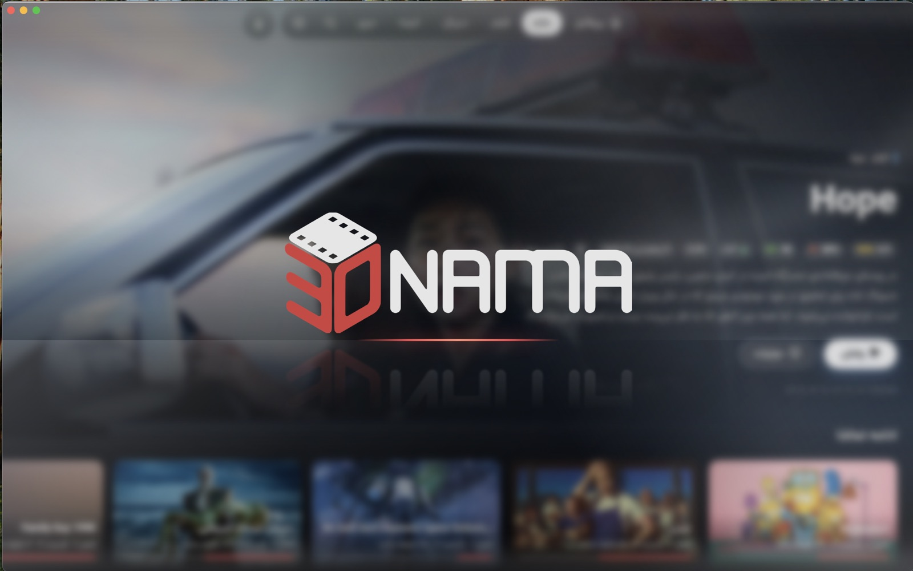
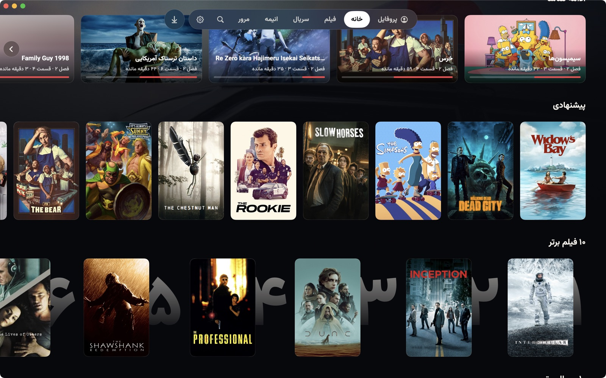
</p>

دو ردیف «۱۰ فیلم برتر» و «۱۰ سریال برتر» رتبهٔ هر عنوان را با عددی به بلندی پوستر کنارش نشان می‌دهند.

### پوسترها و صفحهٔ عنوان

پوستر زیر موس کمی کج می‌شود و برق نوری رویش می‌لغزد. اگر موس کمی رویش بماند، کارتی باز می‌شود با تصویر عریض، امتیاز، ژانر، خلاصه و دکمه‌های پخش و لیست تماشا. با کلیک، همان پوستر تا جای خودش در صفحهٔ عنوان پرواز می‌کند. چند ثانیه که روی صفحهٔ عنوان بمانید، خود فیلم بی‌صدا پشت صفحه پخش می‌شود.

<p align="center">
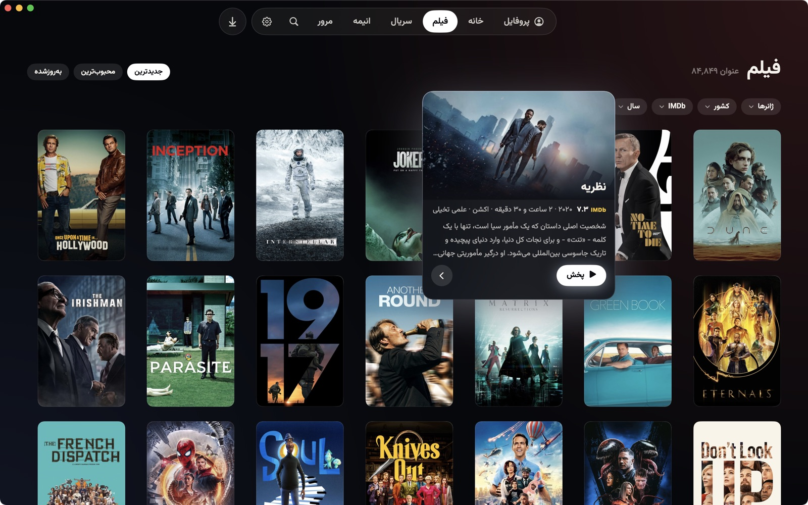
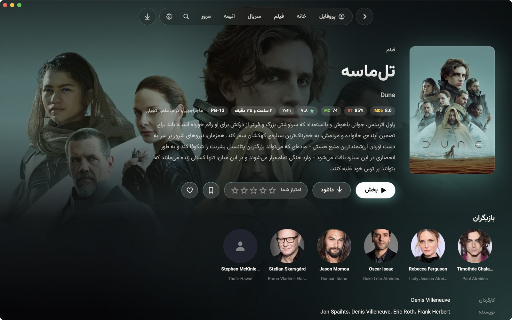
</p>

### جستجو و فهرست‌ها

با ⌘K از هر جای برنامه نوار جستجو باز می‌شود. عنوان‌ها و بخش‌های برنامه همان‌طور که تایپ می‌کنید پیدا می‌شوند؛ با کلیدهای جهت یکی را انتخاب و با Return بازش می‌کنید. فیلم، سریال و انیمه هر کدام فهرست خودشان را دارند: به‌روزشده، جدیدترین یا محبوب‌ترین، با فیلتر ژانر، کشور، امتیاز IMDb و دهه. در «کاوش»، «برنامهٔ هفتگی» نشان می‌دهد کدام سریال و انیمه چه روزی قسمت تازه دارد، و «فهرست‌های برتر» ۲۵۰ فیلم و سریال برتر IMDb و برترهای ۳۰نما را با رتبه‌شان. خبرها، نقدها و اطلاعیه‌های ۳۰نما هم همان‌جاست. روی هر بازیگر بزنید تا بیوگرافی و همهٔ آثارش بیاید، و روی نام کارگردان تا عنوان‌های دیگرش.

<p align="center">
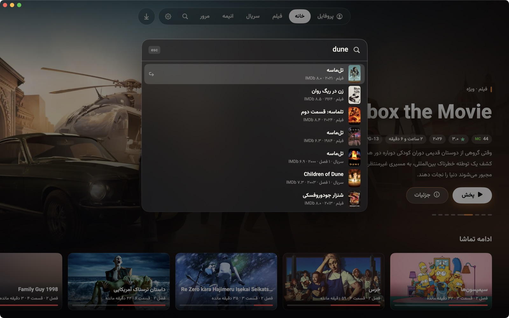
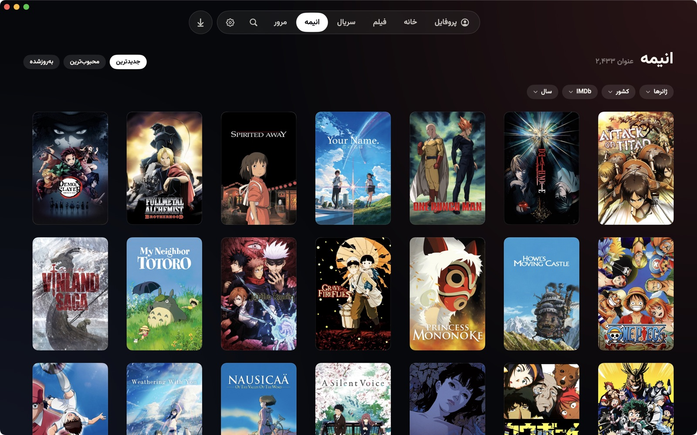
</p>

### پخش

پخش از اینترنت با موتور خود macOS است و فایل‌هایی که macOS نمی‌خواند، مثل MKV، با موتور mpv داخل همان برنامه پخش می‌شوند.

- **ورود سینمایی:** با زدن «پخش»، صفحه تاریک می‌شود و تصویر عنوان تا راه افتادن فیلم جای پنجرهٔ سیاه را می‌گیرد.
- **اطراف تصویر:** جای نوارهای سیاه را می‌شود به نور مات خود صحنه داد. نوار سیاهی هم که داخل خود فایل باشد تشخیص داده و بریده می‌شود. در تنظیمات، با گزینهٔ «اطراف تصویر فیلم» می‌شود یکی از «نوار سیاه، مثل سینما» و «نور صحنه» را انتخاب کرد.
- **نوار زمان:** خلاصهٔ قسمت قبل، تیتراژ و تیتراژ پایانی روی نوار پیداست و دکمهٔ «رد کردن» به‌موقع ظاهر می‌شود.
- **زیرنویس فارسی:** نقطه دیگر اول خط نمی‌افتد و «ي» و «ك» عربی به شکل فارسی نشان داده می‌شوند. زمان‌بندی را می‌شود جابه‌جا کرد و فایل زیرنویس را روی پنجره کشید.
- **کنترل‌ها:** سرعت پخش، کیفیت، میکس صدا، صدا و زیرنویس داخل فایل، تصویر در تصویر، همیشه روی پنجره‌ها، میان‌برهای کیبورد و باز کردن فایل در IINA یا VLC.

### دانلود و زیرنویس

از صفحهٔ هر عنوان کیفیت را انتخاب می‌کنید؛ برای سریال یک قسمت یا کل فصل. فایل به پوشهٔ Downloads می‌رود، یا هر پوشه‌ای که در تنظیمات انتخاب کنید، و دانلود با بستن برنامه قطع نمی‌شود. زیرنویس فارسی هماهنگ با همان نسخه، بدون رفتن به سایت زیرنویس، کنار فیلم و با نام همان فیلم ذخیره می‌شود. اگر فیلم را از قبل دارید، دکمهٔ «زیرنویس» فقط زیرنویس را می‌گیرد.

<p align="center">
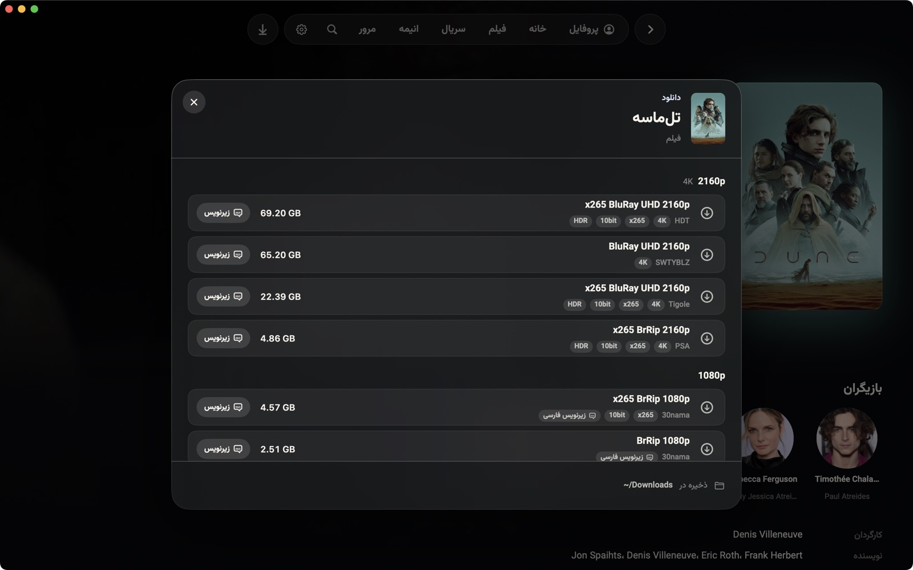
</p>

دانلودها به فیلم، سریال و انیمه دسته‌بندی می‌شوند و دکمهٔ گرد کنار منوی بالا با حلقه‌ای پیشرفتشان را نشان می‌دهد.

### پروفایل و تنظیمات

پروفایل از روی ستاره‌هایتان سلیقه‌تان را نشان می‌دهد و بر همان اساس عنوان پیشنهاد می‌کند. لیست تماشا و علاقه‌مندی‌های حساب ۳۰نمای شما هم همان‌جاست.

<p align="center">
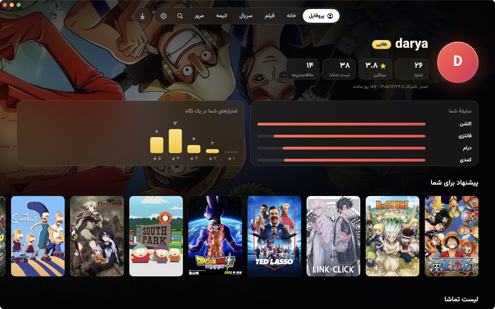
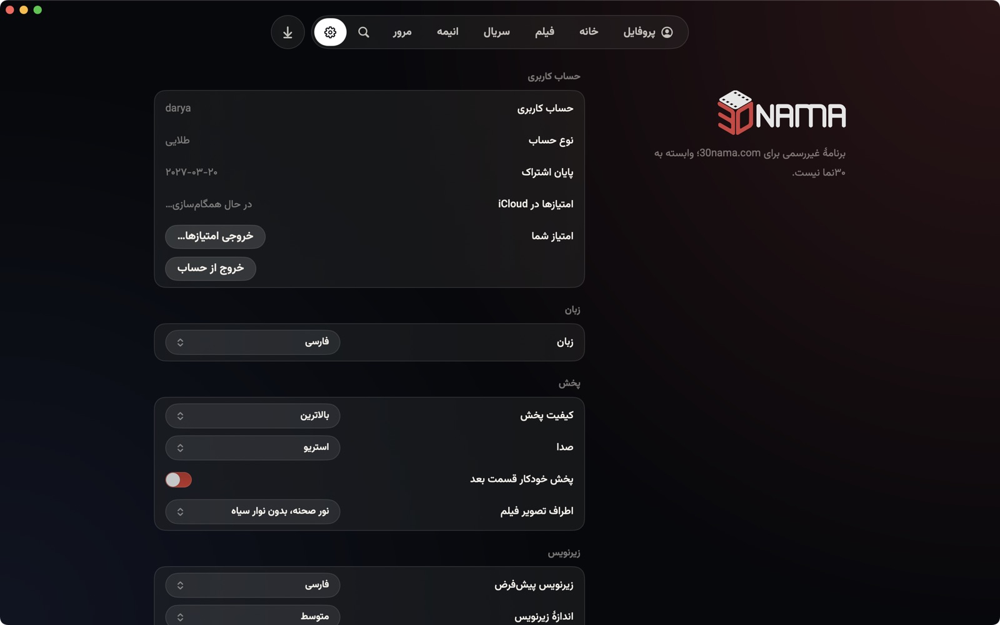
</p>

### کارایی و دسترس‌پذیری

برنامهٔ قدیمی ۳۰نما روی بعضی مک‌ها دستگاه را داغ می‌کرد. این برنامه روی مک‌های اینتل خودش به حالت سبک می‌رود: هیچ‌چیز بی‌پایان حرکت نمی‌کند و وقتی کاری با برنامه ندارید پردازنده بیکار است. روی Apple Silicon جلوه‌ها کامل‌اند و در تنظیمات، بخش «کارایی دستگاه»، می‌شود انتخاب را عوض کرد. VoiceOver هم نام همهٔ دکمه‌ها و پوسترها را می‌خواند.


<a id="windows"></a>

## نسخهٔ ویندوز

<p align="center">
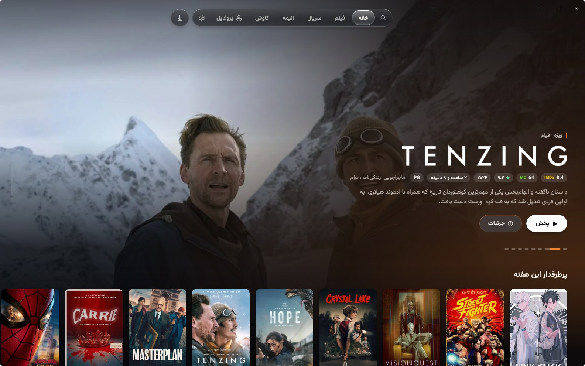
</p>

برنامهٔ ۳۰نما برای کامپیوترهای ویندوز ۱۰ و ۱۱ (۶۴ بیتی)، با موس و کیبورد:

- خانه با عنوان‌های ویژه و ردیف‌های فیلم و سریال، «ادامهٔ تماشا»، و فهرست فیلم و سریال و انیمه با ترتیب و فیلتر.
- صفحهٔ هر عنوان با فصل‌ها و قسمت‌ها، بازیگرها و بیوگرافی هر بازیگر، و «برنامهٔ هفتگی» و «فهرست‌های برتر».
- پخش با موتور mpv، با زیرنویس فارسی، انتخاب کیفیت و صدا. فایل‌های MKV را هم پخش می‌کند.
- دانلود فیلم و قسمت‌ها با چند اتصال هم‌زمان، صف دانلود، ساعت و سقف سرعت دانلود، و زیرنویس فارسی هماهنگ کنار فایل.
- سه زبان فارسی، انگلیسی و عربی، و به‌روزرسانی از داخل خود برنامه.

کدش در پوشهٔ [windows](windows) است.

### نصب

فایل `30nama-windows-1.0.4-setup.exe` را از [صفحهٔ دانلودها](https://github.com/thesaikodelik/30nama-apps/releases/latest) بگیرید.

۱. فایل را اجرا کنید. اول زبان نصب را می‌پرسد.

۲. برنامه گواهی امضای ویندوز ندارد، برای همین بار اول پنجرهٔ آبی «Windows protected your PC» باز می‌شود. **More info** و بعد **Run anyway** را بزنید.

۳. برنامه فقط برای حساب کاربری خودتان نصب می‌شود و رمز مدیر سیستم نمی‌خواهد.

از آن به بعد، برنامه خودش نسخهٔ تازه را خبر می‌دهد و نصبش می‌کند. پیش از نصب، امضای فایل با کلید نسخهٔ ویندوز این پروژه بررسی می‌شود.

### چند نکته

- اگر در تنظیمات «ماندن در کنار ساعت ویندوز» را روشن کنید، با بستن پنجره برنامه کنار ساعت می‌ماند تا دانلودها ادامه پیدا کنند.
- برنامه فقط یک بار باز می‌شود. اگر دوباره بازش کنید، همان پنجرهٔ قبلی جلو می‌آید.
- میان‌برها: <span dir="ltr">Ctrl+K</span> برای جستجوی فوری، <span dir="ltr">Ctrl+F</span> برای صفحهٔ جستجو، <span dir="ltr">Ctrl+1</span> تا <span dir="ltr">Ctrl+8</span> برای رفتن به بخش‌های نوار بالا، و <span dir="ltr">Alt+←</span> برای برگشت.
- iCloud ندارد، پس ستاره‌هایی که می‌دهید روی همان کامپیوتر می‌مانند.

موتور پخش نسخهٔ ویندوز (libmpv) مجوز GPL نسخهٔ ۳ دارد. برای همین فایل نصب ویندوز، که این موتور را همراه دارد، با همین مجوز منتشر می‌شود. کد خود پروژه همچنان MIT است. جزئیات در [THIRD-PARTY-NOTICES.md](THIRD-PARTY-NOTICES.md) آمده است.

<a id="android"></a>

## نسخهٔ اندروید TV

<p align="center">
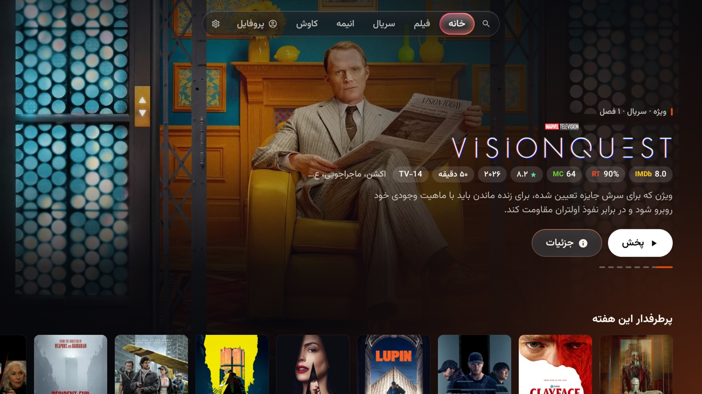
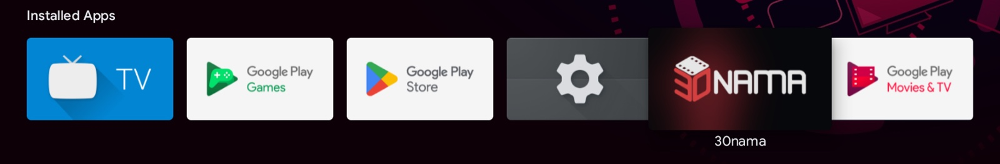
</p>

برنامهٔ ۳۰نما برای تلویزیون‌ها و باکس‌های اندرویدی (Android TV و Google TV، با اندروید ۶ یا بالاتر)، که با کنترل خود تلویزیون کار می‌کند. ظاهرش همان ظاهر نسخهٔ مک است، در اندازه‌ای که از روی مبل خوانده شود:

- خانه با عنوان‌های ویژه، «ادامهٔ تماشا»، ده فیلم و سریال برتر و «پرطرفدار این هفته»، و فهرست فیلم و سریال و انیمه با ترتیب و فیلتر ژانر (چند ژانر با هم)، کشور، امتیاز IMDb و دهه.
- صفحهٔ هر عنوان با فصل‌ها و قسمت‌ها، بازیگرها، همهٔ امتیازها و تریلر، و «کاوش» با برنامهٔ هفتگی، فهرست‌های برتر و اخبار.
- پخش با موتور خود اندروید (Media3)، با زیرنویس فارسی، رد کردن خلاصه و تیتراژ، قسمت بعد، انتخاب کیفیت و صدا. با «Max» خود فایل دانلود پخش می‌شود، اغلب 4K، و برای اینترنت کند کیفیت شروع را می‌شود روی 1080p، 720p یا 480p گذاشت.
- برای عنوانی که هیچ‌جا زیرنویس فارسی ندارد، ترجمهٔ ماشینی زیرنویس انگلیسی با کلید رایگان Gemini خودتان.
- جستجو با صفحه‌کلید فارسی و انگلیسی خود برنامه، چون صفحه‌کلید بیشتر تلویزیون‌ها فارسی ندارد.
- ردیف «ادامهٔ تماشا» در صفحهٔ اصلی خود تلویزیون.
- سه زبان فارسی، انگلیسی و عربی. روی تلویزیون‌های ضعیف حرکت‌های دائمی خاموش می‌شوند تا برنامه روان بماند.

کدش در پوشهٔ [android](android) است.

### نصب

فایل `30nama-android-1.1.1.apk` را از [صفحهٔ دانلودها](https://github.com/thesaikodelik/30nama-apps/releases/latest) بگیرید.

۱. ساده‌ترین راه برنامهٔ Downloader است. آن را از فروشگاه تلویزیون نصب کنید، بازش کنید و کد **7081437** را بزنید. این کد همیشه تازه‌ترین نسخه را می‌دهد. اگر کد کار نکرد، همین نشانی را بدهید:

<div dir="ltr">

```
https://github.com/thesaikodelik/30nama-apps/releases/download/downloads/30nama-android.apk
```

</div>

راه دیگر: فایل را روی فلش بریزید و با یک برنامهٔ مدیریت فایل روی تلویزیون بازش کنید.

۲. تلویزیون بار اول می‌پرسد اجازه می‌دهید Downloader (یا برنامهٔ مدیریت فایل) برنامه نصب کند یا نه. اجازه بدهید و نصب را تأیید کنید. اگر نپرسید یا «App not installed» آمد، این اجازه را خودتان بدهید و دوباره نصب کنید:

- **Google TV** (مثل تلویزیون‌های تازهٔ سونی): Settings › Privacy › Security › Unknown sources، و جلوی Downloader را روشن کنید.
- **Android TV:** Settings › Apps › Security & restrictions › Unknown sources، و جلوی Downloader را روشن کنید.

اگر باز نصب نشد، در همان بخش Security گزینهٔ «Scan apps with Play Protect» (در Android TV: «Verify apps») را تا پایان نصب خاموش کنید و بعد دوباره روشن کنید. برای به‌روزرسانی از داخل برنامه، همین اجازه را خود 30nama هم لازم دارد؛ بار اول خودش می‌پرسد.

۳. ۳۰نما را از صفحهٔ اصلی تلویزیون باز کنید و QR روی صفحه را با گوشی‌ای که در ۳۰نما وارد شده‌اید بزنید.

برنامه نسخهٔ تازه را در تنظیمات خبر می‌دهد و می‌تواند همان‌جا نصبش کند. پیش از نصب، امضای فایل با کلید نسخهٔ اندروید این پروژه بررسی می‌شود. این راه تا حالا فقط روی شبیه‌ساز آزموده شده است؛ اگر روی تلویزیون شما کار نکرد، برنامه صفحهٔ دانلود را با یک QR نشان می‌دهد و فایل تازه را با همان کد Downloader بگیرید. از اندروید ۱۰ به بعد، تلویزیون بعد از به‌روزرسانی برنامه را خودش باز نمی‌کند؛ از صفحهٔ اصلی بازش کنید.

<a id="features"></a>

## برنامهٔ Apple TV

Apple TV جعبهٔ کوچکی از اپل است که به تلویزیون وصل می‌شود و با کنترل خودش کار می‌کند. این برنامه ۳۰نما را روی همان تلویزیون می‌آورد: عنوان‌ها را با کنترل می‌گردید، روی صفحهٔ بزرگ تماشا می‌کنید، و از جایی که رها کرده‌اید ادامه می‌دهید.

برنامه هنوز در App Store نیست و فایل نصب هم ندارد، چون اپل اجازه نمی‌دهد برنامه‌ای از روی فایل روی Apple TV نصب شود. فعلاً برای نصبش باید آن را با Xcode روی یک مک [از روی کد بسازید](#run).

<p align="center">
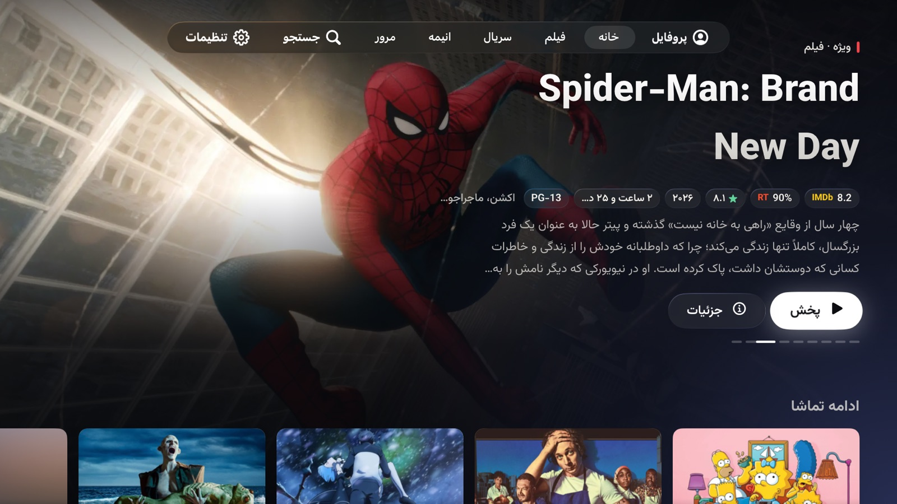
</p>

### خانه و گشتن میان عنوان‌ها

بالای خانه چرخ‌فلکی از عنوان‌های ویژه است و زیرش ردیف‌ها. فوکوس روی هر پوستری که برود، بیلبورد بالای صفحه همان عنوان را نشان می‌دهد و پس‌زمینه هم آرام به تصویر آن محو می‌شود.

<p align="center">
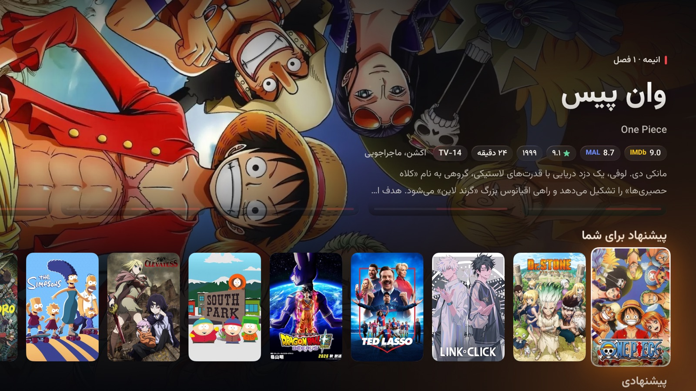
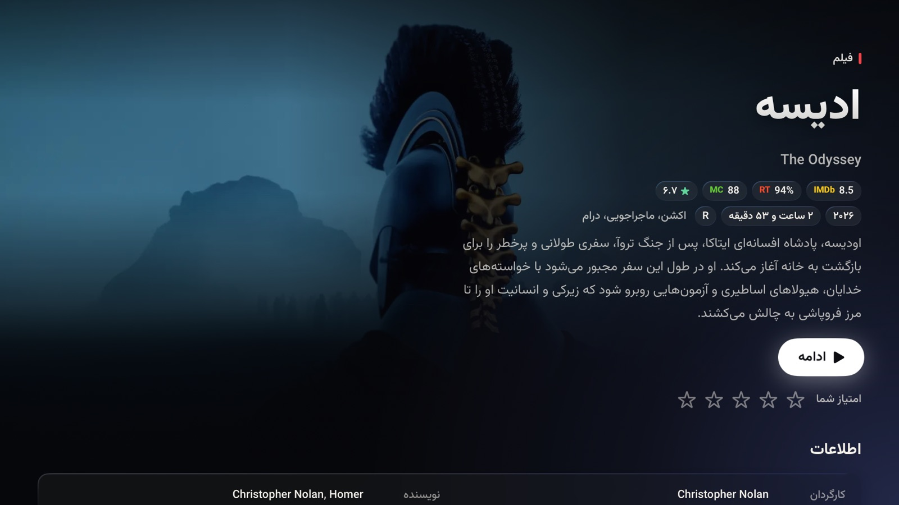
</p>

صفحهٔ هر عنوان فصل‌ها و قسمت‌ها و بازیگرانش را دارد. هر بازیگر را که انتخاب کنید، بیوگرافی‌اش، آن‌طور که در سایت ۳۰نماست، و همهٔ آثارش از تازه‌ترین می‌آید. فیلم، سریال و انیمه هر کدام فهرست خودشان را دارند: به‌روزشده، جدیدترین یا محبوب‌ترین. در «کاوش» می‌شود ژانر به ژانر گشت، و برنامهٔ هفتگی سریال‌ها و فهرست‌های برتر هم همان‌جاست. برای پیدا کردن عنوانی مشخص، جستجو هست.

<p align="center">


</p>

### پخش

پخش‌کننده همان پخش‌کنندهٔ خود tvOS است، پس کنترل همان‌طور رفتار می‌کند که در بقیهٔ برنامه‌های Apple TV به آن عادت دارید. زیرنویس فارسی و انگلیسی با قلم وزیرمتن می‌آید و اندازه، رنگ و پس‌زمینه‌اش از تنظیمات عوض می‌شود. کیفیت و میکس صدا (استریو، ۵.۱ یا صدای اصلی) را از منوی خود پخش‌کننده انتخاب می‌کنید.

سر تیتراژ، خلاصهٔ قسمت قبل و پایان هر قسمت، دکمهٔ قرمزی روی تصویر می‌آید: «رد کردن تیتراژ»، «رد کردن خلاصه» یا «قسمت بعد». با OK کار می‌کند و وقتی نوار پخش باز است کنار می‌رود.

<p align="center">


</p>

جایی که فیلم را رها کرده‌اید در حساب ۳۰نمایتان ثبت می‌شود. ردیف «ادامه تماشا» در خانه نشان می‌دهد از هر عنوان چقدر مانده است، و پخش از همان‌جا ادامه پیدا می‌کند.

<p align="center">
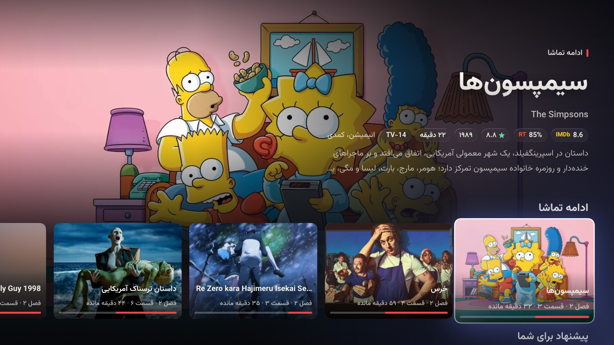
</p>

### ستاره‌ها و پروفایل

به هر عنوان می‌شود از نیم تا پنج ستاره داد. پروفایل از روی همین ستاره‌ها می‌گوید کدام ژانرها بیشتر به دلتان نشسته‌اند و چقدر دست‌ودل‌باز ستاره می‌دهید. از میان عنوان‌های صفحهٔ خانه هم آن‌هایی را پیشنهاد می‌دهد که به سلیقه‌تان نزدیک‌ترند. برای هیچ‌کدام از این‌ها ورود لازم نیست؛ مهمان هم ستاره می‌دهد و پیشنهاد می‌گیرد.

<p align="center">
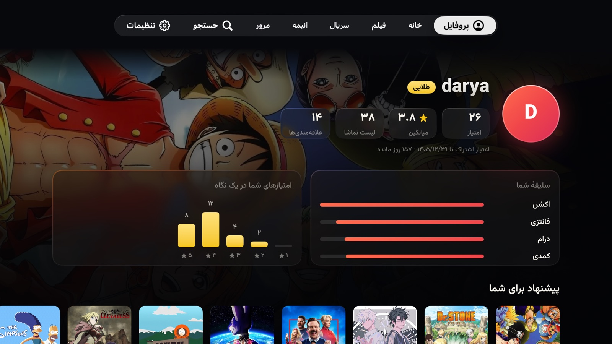
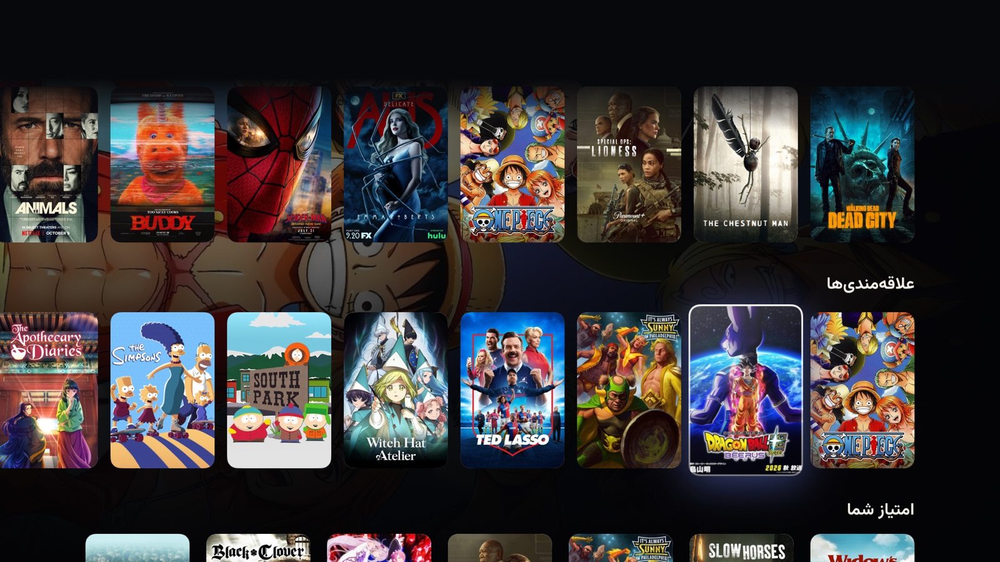
</p>

اگر وارد شده باشید، «لیست تماشا» و «علاقه‌مندی‌ها»ی حسابتان هم همان‌جا می‌آید و تاریخ پایان اشتراک با خطی ریز زیر نامتان نوشته می‌شود.

ستاره‌ها روی خود دستگاه می‌مانند و یک نسخه هم به iCloud خودتان می‌رود. این‌طوری اگر دو Apple TV دارید یا برنامه را پاک و دوباره نصب کردید، چیزی گم نمی‌شود. هیچ‌چیز به سرور ما نمی‌رود، چون سروری در کار نیست.

### سه زبان

رابط به انگلیسی، عربی و فارسی است و در عربی و فارسی راست‌به‌چپ چیده می‌شود. نصب تازه با انگلیسی بالا می‌آید و زبان از تنظیمات عوض می‌شود.

<p align="center">
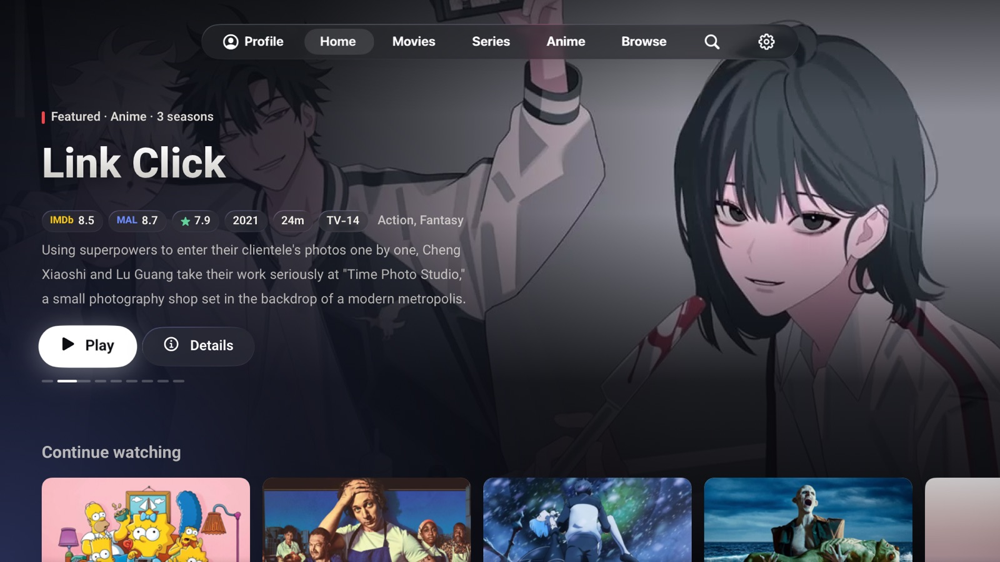
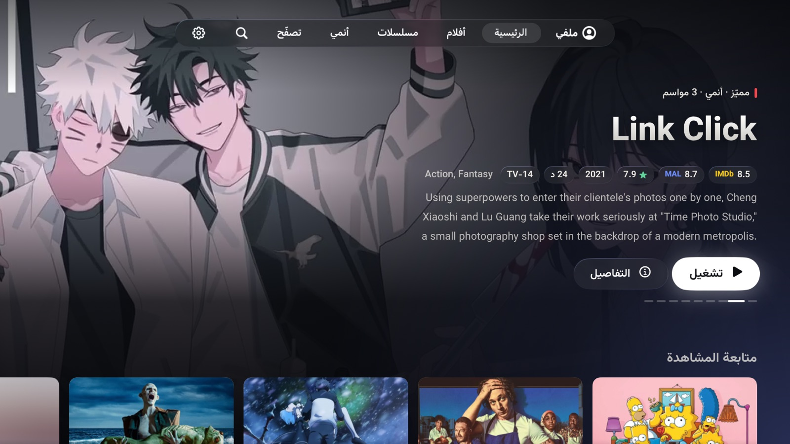
</p>

۳۰نما عنوان و خلاصهٔ فیلم‌ها را فقط به فارسی و انگلیسی دارد، برای همین در رابط عربی این دو انگلیسی می‌مانند. ترجمهٔ عربی را هم هنوز هیچ عرب‌زبانی ندیده است.

### ورود و تنظیمات

ورود با کد QR است: کد را با گوشی اسکن می‌کنید و در سایت ۳۰نما تأیید می‌کنید، بدون این‌که مجبور شوید رمز را با کنترل تلویزیون تایپ کنید. اگر هم نخواستید وارد شوید، به‌عنوان مهمان ادامه می‌دهید.

<p align="center">
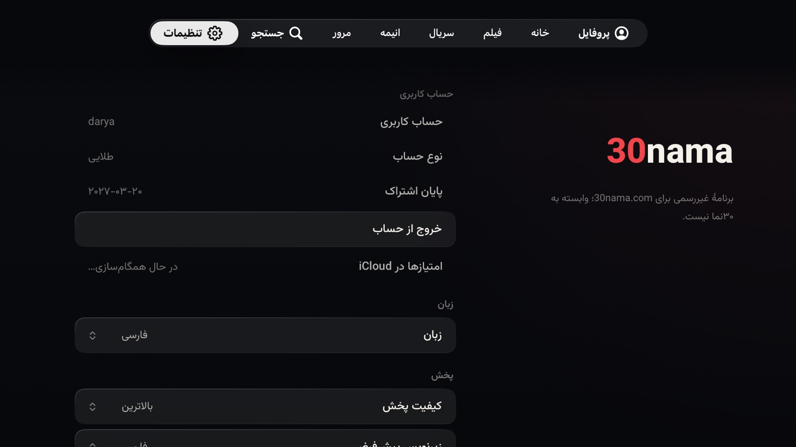
</p>

<p align="center"><sub>دو تصویر پخش‌کننده در حالت دمو و با ویدیوی آزمایشی اپل گرفته شده‌اند. تصویرهای پروفایل، «ادامه تماشا» و تنظیمات هم با حساب و داده‌های نمونه گرفته شده‌اند.</sub></p>

<a id="story"></a>

## می‌خواستیم چه بسازیم و تا کجا رسیدیم

راستش نقشهٔ اول بزرگ‌تر از یک پخش‌کننده بود. می‌خواستیم پروفایل جایی باشد برای پیدا کردن آدم‌های هم‌سلیقه: بقیهٔ کاربران ۳۰نما را جستجو کنید، دنبالشان کنید و ببینید چه دیده‌اند و به کدام فیلم چند ستاره داده‌اند. ستاره‌ای هم که در تلویزیون می‌دهید قرار بود همان امتیازی باشد که در سایت ۳۰نما به اسمتان ثبت است.

ولی API ۳۰نما این اجازه را نداد.

برنامه با API تلویزیون ۳۰نما حرف می‌زند، همان که کلاینت تایزن هم از آن استفاده می‌کند. این API کاتالوگ، جستجو، پخش، ادامهٔ تماشا و لیست‌های خود کاربر را دارد، ولی دستوری برای امتیاز دادن، دیدن پروفایل دیگران یا دنبال کردن کسی در آن نیست. سایت ۳۰نما API جدایی دارد که امتیاز دادن در آن هست، ولی کلید و نشست خودش را می‌خواهد و نشستی را که برنامه با QR می‌گیرد نمی‌پذیرد.

| می‌خواستیم | چرا نشد | به‌جایش چه ساختیم |
|---|---|---|
| ستاره‌های برنامه همان امتیاز سایت باشند | API تلویزیون امتیاز دادن ندارد و API سایت نشست برنامه را قبول نمی‌کند | ستاره‌ها روی دستگاه و در iCloud خود کاربر می‌مانند |
| جستجو و دنبال کردن کاربران دیگر | ۳۰نما اصلاً چنین چیزی ندارد، نه در API تلویزیون و نه در سایت | پروفایل فقط برای خود کاربر است |
| دیدن فیلم‌هایی که دیگران دیده‌اند یا ستاره داده‌اند | پروفایل عمومی هر کاربر در سایت فقط لیست‌هایش را نشان می‌دهد، بدون امتیازها و سابقهٔ تماشا. همان هم از برنامه در دسترس نیست | لیست تماشا و علاقه‌مندی‌های خود کاربر از حسابش خوانده می‌شود |
| ردیف ترندها از TMDB با کلید خودمان | کلید یا باید داخل برنامه باشد، که بیرون کشیدنش کاری ندارد، یا پشت یک سرور، که نداریم. ساختیم، کار کرد و برش داشتیم | ردیف «پرطرفدار این هفته» در مک برگشت، ولی بدون کلیدی در برنامه: از صفحهٔ عمومی TMDB، یا با کلید TMDB خود کاربر |

چیزهایی هم بود که API داشت ولی جایی نگفته بود چطور. نمونه‌اش ثبت جای پخش: سرور فقط موقعیتی را ثبت می‌کند که مضرب ۳۰ ثانیه باشد. عدد دیگری بفرستید جواب موفق می‌دهد و هیچ‌چیز ثبت نمی‌کند. تا این را پیدا نکرده بودیم، «ادامه تماشا» خالی می‌ماند.

### الان کجاییم

هر چه بالاتر دیدید کار می‌کند. ورود، پخش، زیرنویس، انتخاب کیفیت و ثبت جای پخش با یک حساب واقعیِ دارای اشتراک آزموده شده‌اند. همگام‌سازی ستاره‌ها هم با یک حساب iCloud واقعی آزموده شده است، البته از داخل یک برنامهٔ آزمایشی، چون شبیه‌ساز tvOS ورود به iCloud را نمی‌پذیرد.

چیزی که نداریم خود Apple TV است. هر چه خودمان دیده‌ایم روی شبیه‌ساز بوده، و دکمهٔ «قسمت بعد» را فقط در حالت دمو دیده‌ایم. اولین خبر از دستگاه واقعی را یکی از همکاران داد: پخش روی Apple TV با دو HomePod صدا نداشت. همان همکار درستش کرد و حالا پخش با میکس استریو شروع می‌شود.

نسخه‌های مک و ویندوز را می‌شود از [صفحهٔ Releases](https://github.com/thesaikodelik/30nama-apps/releases) نصب کرد. نسخهٔ مک روی مک اینتل و نسخهٔ ویندوز روی یک کامپیوتر ویندوزی، با حساب واقعی، آزموده شده‌اند؛ مک Apple Silicon هنوز نه. برنامهٔ Apple TV هنوز منتشر نشده است. برنامه غیررسمی است و با نام و لوگوی ۳۰نما کار می‌کند، پس قدم بعدی‌اش به خود ۳۰نما بستگی دارد. فعلاً راه نصبش ساختن از روی همین کد است.

اگر از ۳۰نما این را می‌خوانید: با اضافه شدن امتیاز دادن، پروفایل عمومی و دنبال کردن به API تلویزیون، نیمهٔ دیگر این نقشه هم ساختنی است. کد با مجوز MIT همین‌جاست و برای رسمی شدنش هر کمکی از دستمان بربیاید می‌کنیم.

<a id="run"></a>

## ساختن از روی کد

برای ساختن برنامه‌ها Xcode 26 لازم است؛ برای برنامهٔ Apple TV، پلتفرم tvOS هم باید نصب باشد. برنامهٔ Apple TV روی tvOS 17 به بالا اجرا می‌شود و برنامهٔ مک روی macOS 14 به بالا.

<div dir="ltr">

```
git clone https://github.com/thesaikodelik/30nama-apps.git
```

</div>

۱. فایل `30nama.xcodeproj` را باز کنید.

۲. یک شبیه‌ساز Apple TV انتخاب کنید و Run را بزنید. شبیه‌ساز تنظیم دیگری نمی‌خواهد.

۳. برای نصب روی خود Apple TV، فایل `Config/Local.example.xcconfig` را با نام `Config/Local.xcconfig` کپی کنید و شناسهٔ تیم اپل و یک شناسهٔ برنامه برای خودتان در آن بنویسید، چون `app.30nama.tv` را تیم دیگری نمی‌تواند ثبت کند. کانتینر iCloud از روی همان شناسه ساخته می‌شود. این فایل در گیت ثبت نمی‌شود.

برای ساختن نسخهٔ مک، scheme `30nama-mac` را انتخاب کنید و My Mac را مقصد بگذارید. Xcode بار اول موتور پخش mpv را از پکیج MPVKit می‌گیرد.

آنچه از API خود سایت ۳۰نما می‌آید (بیوگرافی بازیگرها، «جدیدترین»، برنامهٔ هفتگی و فهرست‌های برتر) کلیدی می‌خواهد که سایت در مرورگر به همه می‌دهد. این کلید در ریپو نیست. اگر آن را دارید، در `Config/Local.xcconfig` جلوی `NAMA_SITE_KEY` بنویسید. بدون آن هم برنامه‌ها کامل کار می‌کنند و فقط این بخش‌ها پنهان می‌مانند.

نسخهٔ ویندوز روی خود ویندوز و با .NET 8 ساخته می‌شود: فایل `windows/Nama.sln` را باز کنید. کلید سایت در آن‌جا در `windows/Local.props` می‌نشیند (الگویش `windows/Local.example.props`)، و فایل نصب را `windows/tools/build-release.ps1` می‌سازد.

نسخهٔ اندروید TV با JDK 17 یا بالاتر و Android SDK، روی مک یا ویندوز، از داخل پوشهٔ `android` ساخته می‌شود: `./gradlew installDebug` آن را روی تلویزیون یا شبیه‌سازی که با adb وصل است نصب می‌کند، و `./gradlew test` تست‌های منطقش را بدون دستگاه اجرا می‌کند. کلید سایت در `android/local.properties` جلوی `nama.siteKey` می‌نشیند. در بیلد Debug، `adb shell setprop debug.nama.demo 1` همان ویدیوی آزمایشی اپل را جای پخش واقعی می‌گذارد.

### اشتراک ندارید؟

در بیلد Debug متغیر محیطی `NAMA_DEMO=1` را به Scheme اضافه کنید. آن‌وقت هر عنوان، ویدیوی آزمایشی اپل را با زیرنویس و قسمت‌های نمونه پخش می‌کند و می‌شود پخش‌کننده را بدون اشتراک دید.

### تست‌ها

هستهٔ برنامه (مدل‌ها، کلاینت API، تجزیهٔ زیرنویس و BlurHash، ادغام ستاره‌ها) به رابط کاربری وابسته نیست و جدا، به شکل یک پکیج Swift، هم ساخته می‌شود. تست‌هایش روی مک و بدون شبیه‌ساز اجرا می‌شوند:

<div dir="ltr">

```
swift test
```

</div>

### ساختار

| پوشه | چه در آن است |
|---|---|
| `30nama/Core` | مدل‌ها، کلاینت API، تجزیه‌گرها، متن‌های سه زبان و ستاره‌ها. چیزی از رابط کاربری در آن نیست و پکیج تست هم همین را می‌سازد |
| `30nama/Shared` | آنچه برنامهٔ Apple TV و مک هر دو لازم دارند: وضعیت سراسری، انبار iCloud، تم، بارگذاری تصویر، پس‌زمینه، قلم و جایگزین‌های حالت دمو |
| `30nama/App`، `UI`، `Screens`، `Player`، `Resources` | برنامهٔ Apple TV: صفحه‌ها، سبک‌های فوکوس، پخش‌کننده و آیکون |
| `30nama/Mac` | برنامهٔ مک: صفحه‌ها برای موس و کیبورد، پخش‌کننده با موتور سیستم و mpv، دانلود و زیرنویس |
| `Config` | افزوده‌های Info.plist، entitlements و تنظیمات بیلد |
| `windows` | برنامهٔ ویندوز: C# روی .NET 8 و WinUI 3، با هسته و تست‌های خودش، نصاب و ابزارهای ریلیز |
| `Tools` | `make-icons.swift` که آیکون و تصویرهای Top Shelf را از لوگو می‌سازد |
| `Tests` | تست‌های `30nama/Core` |

<a id="contribute"></a>

## همکاری

کد را برای این باز گذاشته‌ایم که کسی بتواند جلوترش ببرد. چند جا هست که کمک همین حالا به کار می‌آید:

- اگر مک Apple Silicon دارید، نسخهٔ مک را نصب کنید و بگویید چطور بود. ما فقط روی مک اینتل آزموده‌ایم.
- اگر ویندوز دارید، به‌خصوص با کارت گرافیک یا صفحهٔ نمایش متفاوت، نسخهٔ ویندوز را امتحان کنید و بگویید چه دیدید.
- اگر Apple TV دارید، برنامه را رویش بسازید و بگویید چه دیدید. ما هنوز آن را روی دستگاه واقعی ندیده‌ایم.
- اگر عربی می‌دانید، متن‌های عربی را در `30nama/Core/L10n.swift` بازبینی کنید.
- اگر راهی برای رسیدن به امتیازها و پروفایل‌های ۳۰نما می‌شناسید که ما ندیده‌ایم، در یک Issue بنویسید.

بقیهٔ کارهای باز در [TASKS.md](TASKS.md) است و آنچه تازه عوض شده در [CHANGELOG.md](CHANGELOG.md). اگر کار بزرگی در نظر دارید، قبلش یک Issue باز کنید تا دوباره‌کاری نشود. پیش از فرستادن Pull Request هم `swift test` را اجرا کنید. قاعده‌های کد در [AGENTS.md](AGENTS.md) آمده است.

## مجوز و اعتبار

کد این پروژه با مجوز [MIT](LICENSE) منتشر شده است. نام و لوگوی ۳۰نما، قلم وزیرمتن و بخش‌هایی که از پروژه‌های دیگر آمده‌اند مجوز خودشان را دارند که در [THIRD-PARTY-NOTICES.md](THIRD-PARTY-NOTICES.md) آمده است.

- این برنامه از روی کلاینت تایزن [msharifi99/30nama-tizenos](https://github.com/msharifi99/30nama-tizenos) نوشتهٔ Rebin Sharifi ساخته شده است: همان API، با برنامه‌ای تازه.
- قلم [وزیرمتن](https://github.com/rastikerdar/vazirmatn) با مجوز SIL Open Font License منتشر شده است.
- نسخهٔ مک فایل‌های MKV را با [mpv](https://mpv.io) و FFmpeg پخش می‌کند که از طریق [MPVKit](https://github.com/mpvkit/MPVKit) و با مجوز LGPL به برنامه اضافه شده‌اند.
- نسخهٔ ویندوز با libmpv پخش می‌کند که مجوز GPL نسخهٔ ۳ دارد، و فایل نصب ویندوز به همین دلیل با همان مجوز منتشر می‌شود.
- نام و لوگوی ۳۰نما متعلق به ۳۰نما است. لوگو روی آیکون و بالای این صفحه فقط برای این است که معلوم باشد برنامه به کدام سرویس وصل می‌شود، و نشانهٔ تأیید یا همکاری ۳۰نما نیست.
- پوسترها و تصویرهایی که در برنامه و در این صفحه می‌بینید متعلق به صاحبان همان آثارند.

</div>
